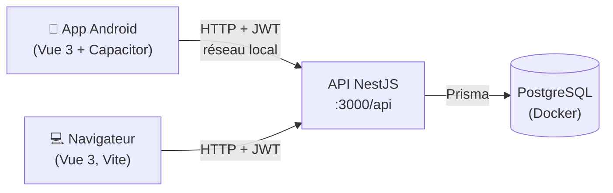

# Moodly

**Moodly** est une application mobile de suivi du moral des salariés, pensée dans une démarche RSE.

- Chaque **employé** renseigne son humeur du jour en moins de 10 secondes : une note de 1 à 5 et, s'il le souhaite, jusqu'à 3 thèmes qui l'expliquent.
- Chaque **manager** consulte l'humeur moyenne de son équipe sur les 30 derniers jours, pour repérer une tendance et en parler collectivement.
- Les réponses sont **anonymes par conception** : un manager ne voit jamais qui a répondu quoi, uniquement des moyennes d'équipe, et les jours avec trop peu de réponses sont masqués.

Projet réalisé à Epitech Digital School (3e année) par Loris, Daysam et Dine.

---

## Sommaire

1. [Fonctionnalités](#fonctionnalités)
2. [Architecture](#architecture)
3. [Installation rapide](#installation-rapide)
4. [Comptes de test](#comptes-de-test)
5. [API](#api)
6. [Tests](#tests)
7. [Lancer sur téléphone (Android)](#lancer-sur-téléphone-android)
8. [Scénario de démo](#scénario-de-démo)
9. [Anonymat et RGPD](#anonymat-et-rgpd)
10. [Documentation](#documentation)

---

## Fonctionnalités

| Écran | Pour qui | Ce qu'on y fait |
|---|---|---|
| Connexion | tout le monde | se connecter avec son email professionnel ; redirection selon le rôle |
| Humeur du jour | employé | choisir une humeur (😞 → 😄) et jusqu'à 3 thèmes parmi 10, envoyer ; une seule réponse par jour. Après une humeur basse (1 ou 2), des ressources de soutien s'affichent (RH, médecine du travail, 3114) |
| Tableau de bord | manager | points « À surveiller » (baisse ou hausse de la moyenne, thème qui revient dans les réponses basses, participation faible), courbe de l'humeur moyenne sur 7, 30 ou 90 jours, moyenne et son évolution par rapport à la période précédente, taux de participation, principales préoccupations, thèmes les plus cités, et le détail jour par jour en tableau |
| Vos données | tout le monde | ce que Moodly enregistre, ce que voit le manager et ce qu'il ne voit jamais ; suppression de son compte |

Les 10 thèmes : charge de travail, ambiance d'équipe, management, équilibre vie pro / perso, reconnaissance, conditions de travail, organisation du travail, communication, autonomie, sens du travail. Aucun thème ne porte sur la santé.

Hors périmètre du MVP, volontairement : historique personnel, inscription libre (les comptes sont fournis par l'employeur), commentaire libre (risque de ré-identification), notifications.

## Architecture



| Couche | Technologies |
|---|---|
| Front | Vue 3, TypeScript, Vite, Vue Router, Pinia, axios, Chart.js (vue-chartjs) |
| Mobile | Capacitor 8 (Android) |
| Back | NestJS 12, TypeScript, Prisma 7 |
| Base de données | PostgreSQL 18 via Docker Compose |
| Authentification | bcrypt + JWT, guards maison (sans Passport) |
| Sécurité | helmet, CORS restreint, limitation des tentatives de connexion, validation des entrées |
| Documentation API | Swagger sur `/api/docs` |
| Tests | Vitest + supertest (tests e2e sur une base dédiée) |

```
backend/    API NestJS (auth, users, moods, stats, health) et schéma Prisma
frontend/   application Vue 3, et projet Android généré par Capacitor (frontend/android)
docs/       tutoriel utilisateur, note RGPD et éthique
docker/     script d'initialisation de PostgreSQL (base de test)
```

## Installation rapide

Prérequis : **Docker Desktop** et **Node.js 22 LTS** (ou plus récent).

```bash
# 1. Base de données (bases moodly et moodly_test)
docker compose up -d

# 2. API
cd backend
cp .env.example .env
npm install
npx prisma migrate dev
npm run seed
npm run start:dev            # http://localhost:3000/api

# 3. Application (dans un second terminal)
cd frontend
cp .env.example .env
npm install
npm run dev                  # http://localhost:5173
```

> Dans `backend/.env`, remplacez `JWT_SECRET` par une longue chaîne aléatoire, par exemple générée avec
> `node -e "console.log(require('crypto').randomBytes(48).toString('hex'))"`.
> L'API refuse de démarrer avec la valeur d'exemple, un secret trop court ou un seuil d'anonymat invalide.

Pour travailler sur le front sans lancer l'API, mettez `VITE_USE_MOCK=true` dans `frontend/.env` : l'application utilise alors des réponses factices.

Pour repartir d'une base vide : `docker compose down -v` puis `docker compose up -d` (le script `docker/init.sql` ne s'exécute qu'au premier démarrage).

## Comptes de test

Créés par `npm run seed`, qui vide puis remplit la base. Mot de passe commun : **`Moodly2026!`**

| Email | Rôle | Équipe |
|---|---|---|
| `manager.produit@moodly.dev` | Manager | Équipe Produit |
| `manager.support@moodly.dev` | Manager | Équipe Support |
| `alice@moodly.dev` | Employée | Équipe Produit (n'a pas encore répondu aujourd'hui : idéale pour la démo) |
| `thomas`, `camille`, `hugo`, `lea`, `julien` + `@moodly.dev` | Employés | Équipe Produit |
| `sarah`, `lucas`, `emma`, `nicolas`, `chloe`, `maxime` + `@moodly.dev` | Employés | Équipe Support |

Les données couvrent les 30 derniers jours ouvrés, avec une **semaine « rush »** en milieu de période (baisse nette du moral, « Charge de travail » très citée) puis une remontée, et des jours à faible participation qui apparaissent **masqués** dans le graphe.

## API

Préfixe : `/api`. Documentation interactive (Swagger) : **http://localhost:3000/api/docs**.

| Route | Accès | Rôle |
|---|---|---|
| `GET /health` | public | vérifier que l'API répond (utile depuis le téléphone) |
| `POST /auth/login` | public, 5 essais par minute | connexion, renvoie un token JWT (8 h) |
| `GET /users/me` | connecté | profil de l'utilisateur |
| `DELETE /users/me` | connecté | suppression du compte (droit à l'effacement), aussi accessible depuis la page « Vos données » |
| `GET /moods/today` | employé | a-t-il déjà répondu aujourd'hui ? |
| `POST /moods` | employé | enregistrer l'humeur du jour |
| `GET /stats/team?days=30` | manager | statistiques agrégées de **sa** propre équipe, avec la moyenne de la période précédente et jusqu'à 3 alertes |

Les erreurs suivent le format NestJS (`statusCode`, `message`, `error`) avec des messages en français.

## Tests

```bash
cd backend
cp .env.test.example .env.test
npm test                     # tests unitaires
npm run test:e2e             # tests de bout en bout, sur la base moodly_test
npm run lint

cd ../frontend
npm run build                # vérification des types + compilation
npm run lint
```

Les tests e2e couvrent la connexion, les droits (401 / 403), la validation des saisies (400, y compris un thème « santé » refusé), la double saisie (409), les statistiques (jours masqués, isolation des équipes, tendance et alertes), la suppression de compte et la suppression automatique des `CheckIn` passés. Ils vérifient aussi **directement en base** qu'une humeur enregistrée ne contient aucune donnée de la personne.

## Lancer sur téléphone (Android)

Prérequis : [Android Studio](https://developer.android.com/studio) (version Otter 2025.2.1 ou plus récente) et un téléphone Android **connecté au même Wi-Fi que le PC**, ou un émulateur.

1. **Trouver l'IP locale du PC.**
   - Windows : `ipconfig`, ligne « Adresse IPv4 » (par exemple `192.168.1.20`).
   - macOS : `ipconfig getifaddr en0`.
   - Linux : `hostname -I`.
2. **Autoriser le port 3000 dans le pare-feu Windows**, une seule fois, dans un PowerShell lancé en administrateur :
   ```powershell
   New-NetFirewallRule -DisplayName "Moodly API" -Direction Inbound -Protocol TCP -LocalPort 3000 -Action Allow
   ```
3. **Vérifier depuis le navigateur du téléphone** que l'API répond : `http://192.168.1.20:3000/api/health` doit afficher `{"status":"ok"}`.
4. **Régler l'URL de l'API** dans `frontend/.env` :
   ```
   VITE_API_URL=http://192.168.1.20:3000/api
   VITE_USE_MOCK=false
   ```
   Sur un **émulateur** Android, le PC est joignable à l'adresse `10.0.2.2` : `VITE_API_URL=http://10.0.2.2:3000/api`.
5. **Construire et ouvrir le projet Android** :
   ```bash
   cd frontend
   npm run android
   ```
   Android Studio s'ouvre : choisissez le téléphone (branché en USB, avec le débogage USB activé) ou l'émulateur, puis cliquez sur ▶ **Run**.

> L'application appelle l'API en HTTP simple, ce qui n'est acceptable que pour une démo sur un réseau local. Ce réglage (`server.cleartext` dans `capacitor.config.ts` et `usesCleartextTraffic` dans le manifeste Android) doit être retiré dès que l'API est servie en HTTPS.

## Scénario de démo

1. `npm run seed` pour repartir des données de démonstration.
2. Sur le téléphone, connexion avec **`alice@moodly.dev`** : choix d'une humeur et de deux thèmes, envoi, écran « Merci, à demain 👋 ». Avec une humeur basse, les ressources de soutien s'affichent. Un nouvel essai le même jour est refusé.
3. Connexion avec **`manager.produit@moodly.dev`** : lecture des points « À surveiller », de la courbe (la semaine « rush » se voit nettement), des jours masqués, de la moyenne et de son évolution, du taux de participation et des principales préoccupations ; passage de 30 à 7 puis 90 jours.
4. Explication de l'anonymat, en s'appuyant sur la page **« Vos données »** (bouton 🔒) : l'humeur est enregistrée sans lien avec la personne, le manager ne reçoit que des moyennes, les jours à moins de 3 réponses sont masqués, et le fait d'avoir répondu est effacé dès le lendemain.

## Anonymat et RGPD

L'anonymat est garanti par la conception, pas seulement par l'interface :

- l'humeur (`Mood`) ne contient **aucun identifiant de personne**, seulement la note, les thèmes, le jour et l'équipe ;
- la table `CheckIn` (personne + jour) sert uniquement à empêcher deux réponses le même jour, **sans aucun lien** avec l'humeur, et elle est **vidée des jours passés** automatiquement ;
- seul le **jour** est enregistré, jamais l'heure, pour qu'on ne puisse pas rapprocher une réponse d'une connexion ;
- le manager ne reçoit que des **agrégats calculés côté serveur**, pour sa seule équipe ;
- un jour avec **moins de 3 réponses est masqué**, et la moyenne globale l'exclut, comme celle de la période précédente ;
- une alerte sur un thème n'apparaît que s'il y a au moins 3 réponses basses sur la période ;
- pas de commentaire libre ni de thème « santé ».

Le détail des choix (données collectées, durée de conservation, risques éthiques, limites) est dans [`docs/rgpd-ethique.md`](docs/rgpd-ethique.md).

## Documentation

- [Tutoriel utilisateur (employé et manager)](docs/tutoriel.md)
- [Note RGPD, anonymisation et éthique](docs/rgpd-ethique.md)
- Documentation de l'API : `http://localhost:3000/api/docs` (une fois l'API lancée)
