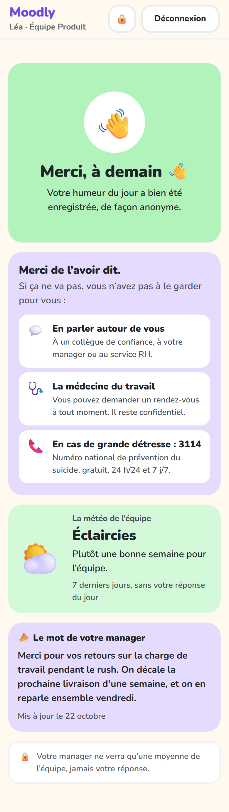
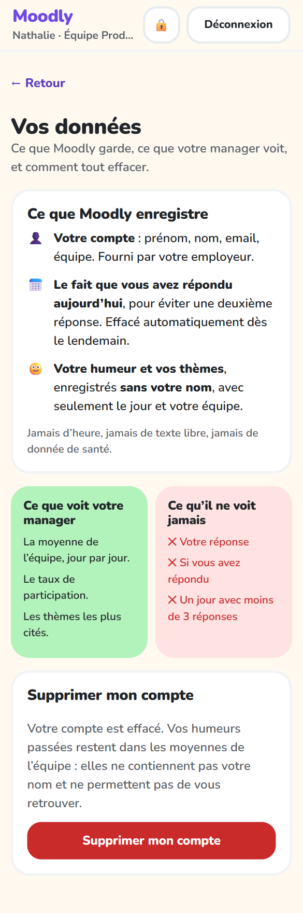

# Tutoriel Moodly

Ce guide explique comment utiliser Moodly au quotidien :

- [Partie 1 : vous êtes employé](#partie-1--vous-êtes-employé), pour donner votre humeur du jour ;
- [Partie 2 : vous êtes manager](#partie-2--vous-êtes-manager), pour suivre le moral de votre équipe ;
- [Partie 3 : vos données](#partie-3--vos-données), pour savoir ce qui est enregistré et supprimer votre compte.

> **En une phrase :** chaque jour, chaque employé indique comment il va en quelques secondes, et le manager voit l'évolution de l'humeur moyenne de son équipe, sans jamais savoir qui a répondu quoi.

---

## Partie 1 : vous êtes employé

### 1. Se connecter

1. Ouvrez l'application **Moodly** sur votre téléphone.
2. Saisissez votre **email professionnel** et votre **mot de passe**, fournis par votre employeur.
3. Touchez **Se connecter**.

Si l'email ou le mot de passe est faux, le message « Email ou mot de passe incorrect » s'affiche. Après 5 essais en une minute, patientez une minute avant de réessayer.

### 2. Donner son humeur du jour

Une fois connecté, l'écran **« Comment allez-vous aujourd'hui ? »** s'affiche.

1. **Touchez la tuile qui vous ressemble**, de 😄 *Très bien* (en haut) à 😞 *Très mal* (en bas). La tuile choisie est entourée et les autres s'estompent. Vous pouvez changer d'avis tant que vous n'avez pas envoyé.
2. **Facultatif :** choisissez **jusqu'à 3 thèmes** qui expliquent votre humeur, parmi 10 :
   - Charge de travail ;
   - Ambiance d'équipe ;
   - Management ;
   - Équilibre vie pro / perso ;
   - Reconnaissance ;
   - Conditions de travail ;
   - Organisation du travail ;
   - Communication ;
   - Autonomie ;
   - Sens du travail.

   Touchez un thème une seconde fois pour le retirer. Au-delà de 3, un message vous invite à en retirer un. Le compteur « 2 / 3 » indique où vous en êtes.
3. Touchez **Envoyer**.

Le bouton **Envoyer** reste grisé tant qu'aucune humeur n'est choisie.

### 3. Confirmation

L'écran **« Merci, à demain 👋 »** confirme que votre réponse est enregistrée.

Vous pouvez répondre **une seule fois par jour**. Si vous rouvrez l'application plus tard dans la journée, c'est cet écran qui s'affiche. Une nouvelle saisie sera possible le lendemain.

Juste en dessous, la tuile **« La météo de l'équipe »** résume le moral de l'équipe sur les 7 derniers jours : ☀️ grand soleil, ⛅ éclaircies, ☁️ nuageux ou 🌧️ pluie. Elle ne compte pas les réponses du jour, donc pas la vôtre, et ne montre jamais de chiffre. S'il n'y a pas eu assez de réponses, elle l'indique simplement.

Si votre manager a publié un message pour l'équipe, il apparaît dans la carte **« Le mot de votre manager »**, sur l'écran de saisie comme sur l'écran de remerciement. C'est sa manière de vous dire ce qu'il a compris des résultats et ce qu'il compte faire.

### 4. Si ça ne va pas

Si vous avez choisi 🙁 *Pas terrible* ou 😞 *Très mal*, l'écran de remerciement affiche aussi **vers qui vous tourner** :

- en parler autour de vous : un collègue de confiance, votre manager ou le service RH ;
- la médecine du travail, que vous pouvez consulter à tout moment, de façon confidentielle ;
- en cas de grande détresse, le **3114**, numéro national de prévention du suicide, gratuit, 24 h/24 et 7 j/7.

Ce message s'affiche seulement sur votre écran : rien n'est enregistré ni envoyé à qui que ce soit.

### 5. Ce que devient votre réponse

- Votre humeur est enregistrée **sans votre nom ni votre identifiant**, uniquement avec la date du jour et votre équipe.
- Le fait que vous avez répondu sert uniquement à bloquer une deuxième réponse le même jour. Il est **effacé automatiquement dès le lendemain**.
- Votre manager ne voit que des **moyennes d'équipe**. Les jours où moins de 3 personnes ont répondu sont **masqués**, pour qu'il ne puisse pas deviner qui a répondu.
- Il n'y a pas de champ de commentaire libre : rien de ce que vous écrivez ne pourrait vous identifier.

### 6. Se déconnecter

Touchez **Déconnexion** en haut à droite de l'écran.

---

## Partie 2 : vous êtes manager

### 1. Se connecter

Connectez-vous avec votre email et votre mot de passe, comme un employé. L'application ouvre directement le **tableau de bord** de votre équipe. Vous ne voyez **que votre équipe**, jamais les autres.

Le tableau de bord s'utilise sur téléphone comme sur ordinateur. Sur un grand écran, le graphe s'affiche en grand, avec les indicateurs à côté.

### 2. Choisir la période

Sous le nom de l'équipe, une étiquette donne la **météo de l'équipe** sur les 7 derniers jours : c'est exactement ce que voient les employés après avoir répondu.

À droite du nom de l'équipe, les boutons **7 j**, **30 j** et **90 j** changent la période affichée. Le graphe et tous les indicateurs se recalculent pour la période choisie. Par défaut, le tableau de bord montre les 30 derniers jours.

### 3. Lire les points « À surveiller »

En haut du tableau de bord, la tuile **« À surveiller »** résume en une à trois phrases ce qui mérite votre attention sur la période :

| Point | Quand il apparaît |
|---|---|
| 📉 **La moyenne baisse** | la moyenne a perdu au moins 0,3 point par rapport à la période précédente de même durée |
| 🔎 **Un thème revient** | un thème est cité dans au moins 40 % des réponses basses (1 ou 2 sur 5), et il y a au moins 3 réponses basses |
| 🙋 **Participation faible** | moins de la moitié des réponses possibles : les résultats sont moins représentatifs |
| 🌱 **La moyenne monte** | la moyenne a gagné au moins 0,3 point par rapport à la période précédente |

S'il n'y a rien à signaler, la tuile l'indique simplement. Sous la moyenne, une petite étiquette donne aussi l'évolution (▲ ou ▼) par rapport à la période précédente.

### 4. Lire le graphe

Le graphe **« L'humeur, jour par jour »** montre l'humeur moyenne de l'équipe sur la période choisie.

| Élément | Signification |
|---|---|
| Axe vertical | l'échelle des humeurs, de 😞 (1) à 😄 (5) |
| Axe horizontal | les jours, au format JJ/MM |
| Points | la moyenne du jour ; leur couleur reprend le niveau d'humeur (rouge quand c'est bas, vert quand c'est haut) |
| Ligne fine « neutre » | le niveau 3 (😐) : au-dessus, l'équipe va plutôt bien ; en dessous, plutôt mal |
| **Trous dans la courbe** | des **jours masqués** : moins de 3 réponses ce jour-là (souvent les week-ends), pour protéger l'anonymat |

En touchant ou en survolant un point, une bulle affiche le jour, la moyenne et le nombre de réponses.

Sous le graphe, **« Voir les données jour par jour »** déplie un tableau avec les mêmes informations. Il est pratique pour retrouver un chiffre précis.

### 5. Lire les indicateurs

| Indicateur | Ce qu'il mesure |
|---|---|
| **Moyenne sur la période** | l'humeur moyenne de l'équipe sur les jours visibles ; la tuile prend la couleur du niveau correspondant |
| **Taux de participation** | la part de réponses obtenues par rapport au maximum possible (nombre d'employés × jours ouvrés) |
| **Principales préoccupations** | les 3 thèmes les plus cités quand l'humeur est basse (1 ou 2 sur 5) : les causes probables du mal-être |
| **Thèmes les plus cités** | les 3 thèmes les plus cités, toutes humeurs confondues |

S'il y a trop peu de réponses sur la période, ces indicateurs ne s'affichent pas, toujours pour protéger l'anonymat.

### 6. Interpréter et agir

Moodly sert à repérer une **tendance d'équipe**, pas à évaluer des personnes. Quelques repères :

- **Une baisse sur plusieurs jours** (comme une semaine chargée) compte davantage qu'un jour isolé. Croisez-la avec les **principales préoccupations** : si « Charge de travail » arrive en tête pendant la baisse, la cause probable est identifiée.
- **Changez de période** pour prendre du recul : sur 90 jours, on distingue une mauvaise semaine d'une tendance de fond.
- **Parlez-en collectivement**, en réunion d'équipe : « l'humeur a baissé la semaine dernière et la charge de travail revient souvent, qu'est-ce qui pourrait aider ? ».
- **N'essayez jamais de deviner qui a répondu quoi.** L'outil est conçu pour l'empêcher, et la confiance de l'équipe en dépend.
- **Une participation faible** est aussi une information : elle peut traduire un manque de confiance dans l'outil ou une période chargée. Rappelez que les réponses sont anonymes et facultatives.

### 7. Écrire à votre équipe

En bas du tableau de bord, la tuile **« Votre message à l'équipe »** permet de publier un court message (280 caractères au plus). Toute l'équipe le voit sur son écran de saisie.

- Écrivez ce que vous avez compris et ce que vous allez faire : « Merci pour vos retours sur la charge de travail. On décale la prochaine livraison d'une semaine. »
- **Mettre à jour** remplace l'ancien message ; **Retirer** le supprime.
- Le message ne s'adresse jamais à une personne : vous ne savez pas qui a répondu quoi, et c'est voulu.

Montrer à l'équipe que ses réponses sont lues et suivies d'effets est la meilleure façon de garder une participation élevée.

### 8. Se déconnecter

Touchez **Déconnexion** en haut à droite.

---

## Partie 3 : vos données

Le bouton **🔒** en haut à droite, à côté de **Déconnexion**, ouvre la page **« Vos données »**. Elle est aussi accessible depuis le lien **« En savoir plus »** sous l'écran de saisie. Elle présente :

- **ce que Moodly enregistre** : votre compte, le fait que vous avez répondu aujourd'hui (effacé dès le lendemain), et votre humeur, sans votre nom ;
- **ce que voit votre manager**, et **ce qu'il ne voit jamais** ;
- le bouton **Supprimer mon compte**.

### Supprimer son compte

1. Ouvrez **« Vos données »** avec le bouton 🔒.
2. Touchez **Supprimer mon compte**.
3. Lisez l'avertissement, puis touchez **Oui, supprimer**. Vous pouvez aussi **Annuler**.
4. Votre session est fermée, et la page de connexion affiche « Votre compte a bien été supprimé ».

La suppression est **définitive**. Elle efface votre compte. Vos humeurs passées restent dans les moyennes de l'équipe : elles ne contiennent pas votre nom et ne permettent pas de vous retrouver.

---

## Questions fréquentes

**Mon manager peut-il savoir ce que j'ai répondu ?**
Non. Votre humeur n'est jamais reliée à votre compte, et les jours avec moins de 3 réponses sont masqués.

**Mon manager peut-il savoir si j'ai répondu ?**
Non. Il voit seulement le taux de participation de toute l'équipe. Le fait que vous avez répondu n'est conservé que le jour même, pour bloquer une deuxième réponse.

**Puis-je modifier ma réponse ?**
Non, une seule réponse par jour, sans modification possible. Cela évite de pouvoir relier une modification à une personne.

**Puis-je supprimer mon compte ?**
Oui, depuis la page « Vos données » (bouton 🔒), voir la partie 3.

**Pourquoi n'y a-t-il pas de thème « santé » ou « stress » ?**
Ce seraient des informations sur votre santé, que la loi protège particulièrement. Moodly s'en tient au contexte de travail.

**L'application ne se connecte pas.**
Vérifiez que votre téléphone est sur le même réseau Wi-Fi que le serveur, puis réessayez. Si le problème persiste, contactez la personne qui administre l'application.
