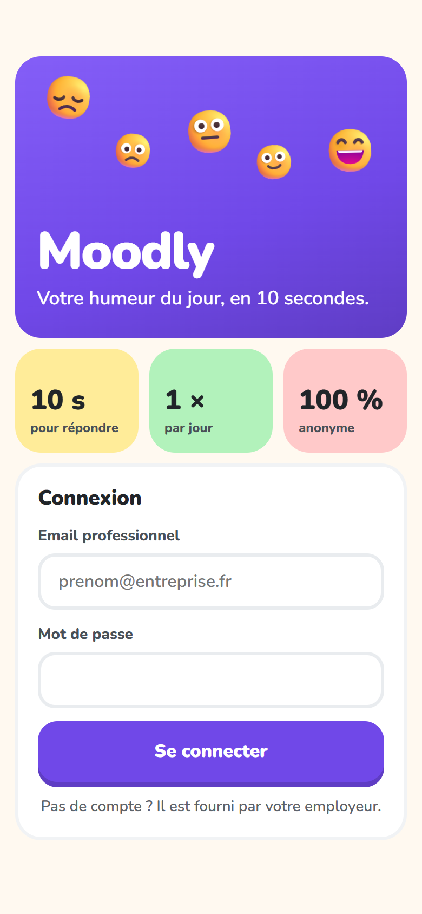
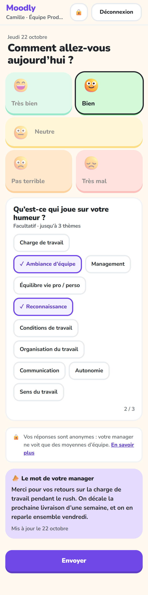
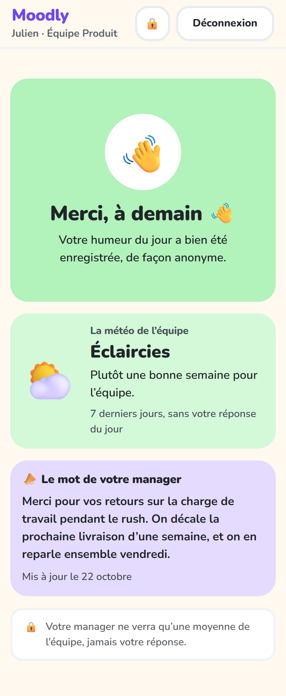
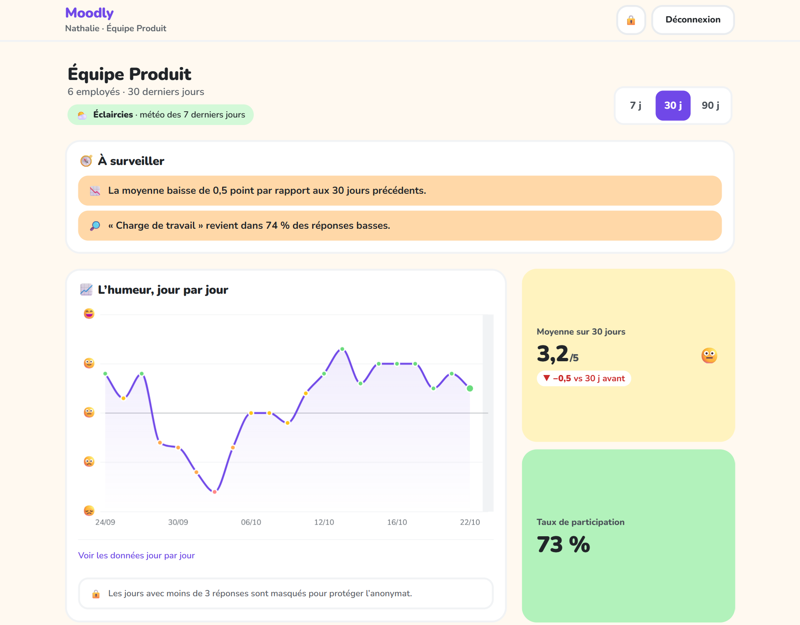
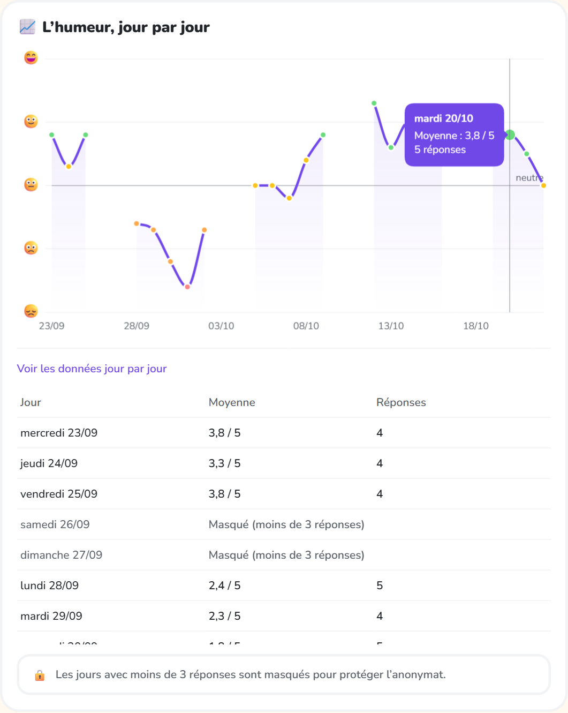

# Tutoriel Moodly

Ce guide explique comment utiliser Moodly au quotidien :

- [Partie 1 : vous êtes employé](#partie-1--vous-êtes-employé), pour donner votre humeur du jour ;
- [Partie 2 : vous êtes manager](#partie-2--vous-êtes-manager), pour suivre le moral de votre équipe.

> **En une phrase :** chaque jour, chaque employé indique comment il va en quelques secondes, et le manager voit l'évolution de l'humeur moyenne de son équipe, sans jamais savoir qui a répondu quoi.

---

## Partie 1 : vous êtes employé

### 1. Se connecter

1. Ouvrez l'application **Moodly** sur votre téléphone.
2. Saisissez votre **email professionnel** et votre **mot de passe**, fournis par votre employeur.
3. Touchez **Se connecter**.

Si l'email ou le mot de passe est faux, le message « Email ou mot de passe incorrect » s'affiche. Après 5 essais en une minute, patientez une minute avant de réessayer.

### 2. Donner son humeur du jour

Une fois connecté, l'écran **« Comment allez-vous aujourd'hui ? »** s'affiche.

1. **Touchez l'émoji qui vous ressemble**, de 😞 *Très mal* à 😄 *Très bien*. L'humeur choisie s'écrit sous les émojis, et la couleur de l'écran s'adapte.
2. **Facultatif :** choisissez **jusqu'à 3 thèmes** qui expliquent votre humeur :
   - Charge de travail ;
   - Ambiance d'équipe ;
   - Management ;
   - Équilibre vie pro / perso ;
   - Reconnaissance ;
   - Conditions de travail.

   Touchez un thème une seconde fois pour le retirer. Au-delà de 3, un message vous invite à en retirer un.
3. Touchez **Envoyer**.

Le bouton **Envoyer** reste grisé tant qu'aucune humeur n'est choisie.

### 3. Confirmation

L'écran **« Merci, à demain 👋 »** confirme que votre réponse est enregistrée.

Vous pouvez répondre **une seule fois par jour**. Si vous rouvrez l'application plus tard dans la journée, c'est cet écran qui s'affiche. Une nouvelle saisie sera possible le lendemain.

### 4. Ce que devient votre réponse

- Votre humeur est enregistrée **sans votre nom ni votre identifiant**, uniquement avec la date du jour et votre équipe.
- Votre manager ne voit que des **moyennes d'équipe**. Les jours où moins de 3 personnes ont répondu sont **masqués**, pour qu'il ne puisse pas deviner qui a répondu.
- Il n'y a pas de champ de commentaire libre : rien de ce que vous écrivez ne pourrait vous identifier.

### 5. Se déconnecter

Touchez **Déconnexion** en haut à droite de l'écran.

---

## Partie 2 : vous êtes manager

### 1. Se connecter

Connectez-vous avec votre email et votre mot de passe, comme un employé. L'application ouvre directement le **tableau de bord** de votre équipe. Vous ne voyez **que votre équipe**, jamais les autres.

Le tableau de bord s'utilise sur téléphone comme sur ordinateur. Sur un grand écran, le graphe s'affiche en grand, avec les indicateurs à côté.

### 2. Lire le graphe

Le graphe **« L'humeur, jour par jour »** montre l'humeur moyenne de l'équipe sur les 30 derniers jours.

| Élément | Signification |
|---|---|
| Axe vertical | l'échelle des humeurs, de 😞 (1) à 😄 (5) |
| Axe horizontal | les jours, au format JJ/MM |
| Points | la moyenne du jour ; leur couleur reprend le niveau d'humeur (terre cuite quand c'est bas, vert quand c'est haut) |
| Ligne fine « neutre » | le niveau 3 (😐) : au-dessus, l'équipe va plutôt bien ; en dessous, plutôt mal |
| **Trous dans la courbe** | des **jours masqués** : moins de 3 réponses ce jour-là (souvent les week-ends), pour protéger l'anonymat |

En touchant ou en survolant un point, une bulle affiche le jour, la moyenne et le nombre de réponses.

Sous le graphe, **« Voir les données jour par jour »** déplie un tableau avec les mêmes informations. Il est pratique pour retrouver un chiffre précis.

### 3. Lire les indicateurs

| Indicateur | Ce qu'il mesure |
|---|---|
| **Moyenne sur 30 jours** | l'humeur moyenne de l'équipe sur les jours visibles ; la carte prend la couleur du niveau correspondant |
| **Taux de participation** | la part de réponses obtenues par rapport au maximum possible (nombre d'employés × jours ouvrés) |
| **Principales préoccupations** | les 3 thèmes les plus cités quand l'humeur est basse (1 ou 2 sur 5) : les causes probables du mal-être |
| **Thèmes les plus cités** | les 3 thèmes les plus cités, toutes humeurs confondues |

S'il y a trop peu de réponses sur la période, ces indicateurs ne s'affichent pas, toujours pour protéger l'anonymat.

### 4. Interpréter et agir

Moodly sert à repérer une **tendance d'équipe**, pas à évaluer des personnes. Quelques repères :

- **Une baisse sur plusieurs jours** (comme une semaine chargée) compte davantage qu'un jour isolé. Croisez-la avec les **principales préoccupations** : si « Charge de travail » arrive en tête pendant la baisse, la cause probable est identifiée.
- **Parlez-en collectivement**, en réunion d'équipe : « l'humeur a baissé la semaine dernière et la charge de travail revient souvent, qu'est-ce qui pourrait aider ? ».
- **N'essayez jamais de deviner qui a répondu quoi.** L'outil est conçu pour l'empêcher, et la confiance de l'équipe en dépend.
- **Une participation faible** est aussi une information : elle peut traduire un manque de confiance dans l'outil ou une période chargée. Rappelez que les réponses sont anonymes et facultatives.

### 5. Se déconnecter

Touchez **Déconnexion** en haut à droite.

---

## Questions fréquentes

**Mon manager peut-il savoir ce que j'ai répondu ?**
Non. Votre humeur n'est jamais reliée à votre compte, et les jours avec moins de 3 réponses sont masqués.

**Puis-je modifier ma réponse ?**
Non, une seule réponse par jour, sans modification possible. Cela évite de pouvoir relier une modification à une personne.

**Puis-je supprimer mon compte ?**
Oui. Dans cette première version, il n'y a pas encore de bouton dans l'application : adressez la demande à la personne qui administre Moodly. La suppression efface votre compte et l'historique des jours où vous avez répondu. Vos humeurs passées restent dans les moyennes de l'équipe, puisqu'elles sont anonymes et ne permettent pas de vous identifier.

**L'application ne se connecte pas.**
Vérifiez que votre téléphone est sur le même réseau Wi-Fi que le serveur, puis réessayez. Si le problème persiste, contactez la personne qui administre l'application.
